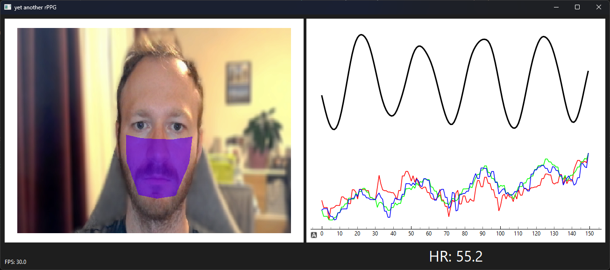

<div align="center">

# CardioSight

**Non-Contact Remote Photoplethysmography (rPPG) & Real-Time Heart Rate Monitoring in Python**

[](https://www.python.org/downloads/)
[](https://opencv.org/)
[](https://developers.google.com/mediapipe)
[](https://riverbankcomputing.com/software/pyqt/)
[](https://github.com/astral-sh/ruff)

<br/>



<p><em>Real-time pulse waveform visualization and non-contact heart rate extraction from a live camera feed.</em></p>

</div>

---

## 📌 Overview

**CardioSight** is a modular Python framework for **remote photoplethysmography (rPPG)**. rPPG refers to the optical, non-contact measurement of blood volume pulses using standard RGB video cameras or webcams. 

With every heartbeat, blood flows through facial vascular beds, causing microscopic variations in skin color caused by the differential absorption of ambient light by oxygenated hemoglobin. CardioSight tracks facial regions of interest, extracts subtle physiological pulse signals, filters out ambient noise, and computes heart rate (BPM) in real time or from recorded videos.

> [!CAUTION]
> **Medical Disclaimer:** CardioSight is an open-source research and educational hobby project intended solely for demonstration, experimentation, and research. It is **not** a certified medical device and must **never** be used for clinical diagnostics, patient monitoring, or medical decision-making.

---

## ✨ Features

- 📹 **Real-Time Camera Extraction:** Stream video directly from your webcam and compute pulse waveforms on the fly.
- 🎞️ **Offline Video Analysis:** Process pre-recorded video files (`.mp4`, `.avi`, etc.) frame-by-frame in batch mode.
- 👤 **AI-Driven Facial ROI Detection:**
  - **MediaPipe FaceMesh landmarker** (default, fast, tracking lower facial regions).
  - **Selfie Segmentation** (full-face skin isolation).
- 🔬 **Signal Extractors & Processors:**
  - **Green Channel Averaging** (classic rPPG baseline).
  - **CHROM Processor** (Chrominance-based method robust to motion and skin illumination shifts).
  - **Digital Filtering** (Butterworth bandpass filters tuned to human physiological heart rate bands).
- 📈 **Multiple User Interfaces:**
  - **OpenCV Lightweight UI** (fast, zero extra dependencies).
  - **Qt6 Dashboard UI** (rich PyQt6 + PyQtGraph interface displaying live waveform history, FFT/pulse signal, and BPM).
- ⚙️ **Configurable Architecture:** Built on top of [Hydra](https://hydra.cc) for flexible CLI argument overrides.

---

## 🏗️ Architecture & Pipeline


1. **ROI Detection:** Identifies facial boundaries and creates dynamic masks for the skin tissue regions.
2. **Signal Extraction:** Evaluates spatial color variations over time across selected regions of interest.
3. **Filtering:** Applies temporal bandpass filters (e.g. 0.5 Hz – 2.0 Hz, corresponding to 30–120 BPM) to eliminate lighting drift and motion noise.
4. **Heart Rate Estimation:** Detects signal systolic peaks over sliding temporal buffers to calculate beats per minute (BPM).

---

## 🚀 Getting Started

### 1. Prerequisites

- Python 3.10 or higher
- Git
- A working webcam (for real-time capture)

### 2. Clone the Repository

```bash
git clone https://github.com/Rohan-Lenka/Cardio-Sight.git
cd Cardio-Sight
```

### 3. Create a Virtual Environment

```bash
# Using venv
python -m venv .venv

# Activate on Windows (PowerShell):
.\.venv\Scripts\Activate.ps1

# Activate on Linux/macOS:
source .venv/bin/activate
```

### 4. Installation

#### Basic Installation (OpenCV Interface)
```bash
pip install "."
```

#### Full Installation (Recommended: includes Qt6 GUI & PyQtGraph)
```bash
pip install ".[qt6]"
```

#### Developer / Docs Installation
```bash
pip install ".[dev]"
```

---

## 💻 Usage

### Command Line Interface (CLI)

CardioSight exposes the `run-yarppg` command to launch the application.

#### 1. Launch Simple OpenCV Window
```bash
run-yarppg
```

#### 2. Launch Qt6 Dashboard (Rich Visualizer)
```bash
run-yarppg ui=qt6_simple
```

#### 3. Customize Options via Hydra Overrides
You can override any parameter directly from the command line:

```bash
# Use a specific webcam index (e.g., secondary camera 1)
run-yarppg ui.video=1

# Process a video file instead of a live webcam
run-yarppg ui.video="path/to/facial_video.mp4"

# Use CHROM algorithm instead of green channel
run-yarppg algorithm=chrom

# Adjust bandpass filter frequencies (f1=0.7 Hz / 42 BPM, f2=3.0 Hz / 180 BPM)
run-yarppg filter.f1=0.7 filter.f2=3.0

# View all available CLI configuration options
run-yarppg --help
```

---

### Python API

You can easily integrate CardioSight into your own computer vision or machine learning scripts.

#### Live Video Frame Loop

```python
import cv2
import yarppg

# Initialize rPPG pipeline orchestrator
rppg = yarppg.Rppg()

cap = cv2.VideoCapture(0)

while cap.isOpened():
    ret, frame = cap.read()
    if not ret:
        break

    # Convert BGR to RGB for processing
    rgb_frame = cv2.cvtColor(frame, cv2.COLOR_BGR2RGB)
    
    # Process single frame
    result = rppg.process_frame(rgb_frame)

    if result.hr is not None:
        print(f"Signal: {result.value:.4f} | Estimated HR: {result.hr:.1f} BPM")

cap.release()
```

#### Offline Video File Batch Processing

```python
import yarppg

# Initialize orchestrator
rppg = yarppg.Rppg()

# Process an entire video file in one call
video_path = "sample_face_video.mp4"
df_results = rppg.process_video(video_path)

print(df_results.head())
```

---

```bash
mkdocs serve
```
Open `http://127.0.0.1:8000/` in your browser to view the interactive documentation.

---

## 📚 References & Scientific Background

CardioSight builds on established computer vision and biomedical optics research:

1. **Verkruysse, W., Svaasand, L. O., & Nelson, J. S. (2008).** *Remote plethysmographic imaging using ambient light.* Optics Express, 16(26), 21434–21445. [doi:10.1364/oe.16.021434](https://doi.org/10.1364/oe.16.021434)
2. **de Haan, G., & Jeanne, V. (2013).** *Robust pulse rate from chrominance-based rPPG.* IEEE Transactions on Biomedical Engineering, 60(10), 2878–2886. [doi:10.1109/TBME.2013.2266196](https://doi.org/10.1109/TBME.2013.2266196)
3. **Li, X., Chen, J., Zhao, G., & Pietikäinen, M. (2014).** *Remote Heart Rate Measurement From Face Videos Under Realistic Situations.* IEEE CVPR, pp. 4264–4271. [doi:10.1109/CVPR.2014.543](https://doi.org/10.1109/CVPR.2014.543)

---